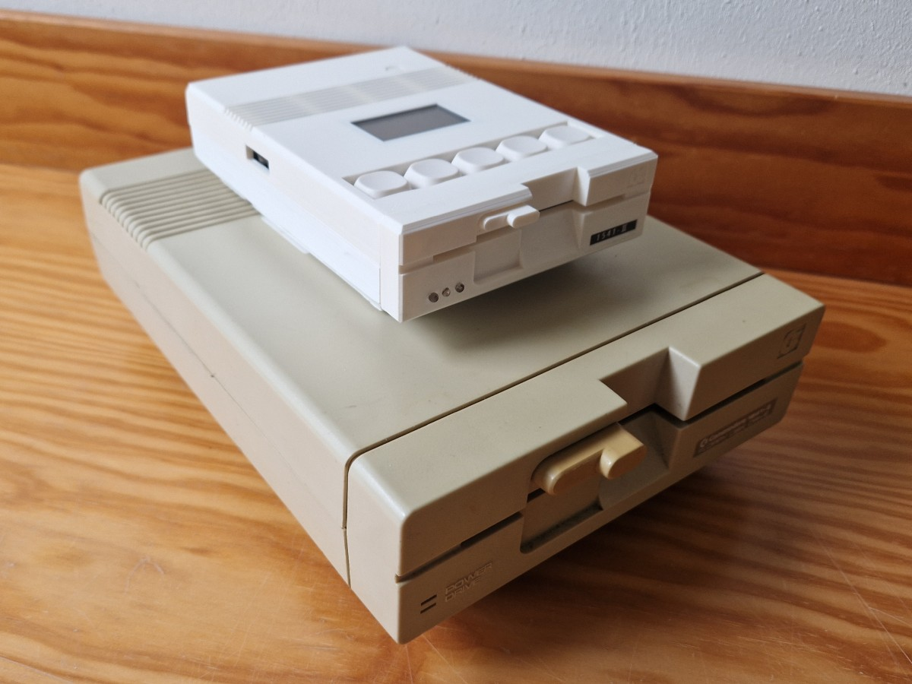
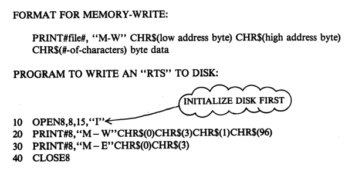

Maarten Pennings MCC#06

# Pi1541

Ik heb zelf een Pi1541 gemaakt.
Dit is een Raspberry Pi die een Commodore 1541 disk drive emuleert.
Het bijzondere is dat deze emulatie de echte 1541 firmware draait, 
en dat deze emulatie ook nog dezelfde timing heeft als 
de oorspronkelijke firmware.

Het was voor mij niet meteen duidelijk wat de verschillen zijn met bijvoorbeeld 
de SD2IEC. En ik begreep ook niet goed waarom er een schermpje op zit en wat toetsen.
In dit artikel bespreek ik de architectuur van de Pi1541 en hoe hij in de praktijk 
gebruikt kan worden.

## Introductie

De _Commodore 1451_ is een 5.25-inch floppy disk drive.
Het was _het_ opslag medium van de Commodore 64 (C64).
Maar in de loop der jaren zijn de disks en de drives veroudered of zelfs kapot gegaan;
en ook wat klein en langzaam naar huidge maatstaven.
Daarom zijn er alternatieven ontwikkeld. Een daarvan is de _Pi1541_.

Een belangrijke voorganger van de Pi1541 is de SD2IEC.
De SD2IEC bevat een ATmega644 microcontroller die een brug slaat
tussen de _Commodore serial bus_ (IEC) en het FAT file systeem 
op de SD kaart. Dit stelt de C64 in staat om files te bewaren 
op een SD kaart.

De SD2IEC is goedkoop en kan veel files bewaren: 25000 floppy disks van 170kB
op een 4GB SD kaart. Hij is klein en kan bijvoorbeeld via de _user port_ 
van stroom voorzien worden. Het grote nadeel is dat de SD2IEC weliswaar  
compatibel is met _file_ commando's, maar niet met _programming_ commando's. 
Dat zijn commando's die het geheugen van de 1541 manipuleren.

Omdat de oorspronkelijke 1541 drive langzaam is, hebben vele commerciële 
programma's, demos en games een eigen _fast loader_. Dit soort _fast loaders_ 
gebruiken die _programming_ commando's om de 1541 firmware uit te breiden.
Dat ondersteunt de SD2IEC niet, en daarmee kan veel software niet geladen 
met de SD2IEC.

De Pi1514 van Steve White lost dit probleem op. Hij gebruikt geen _ATmega644_
maar de veel krachtigere _Raspberry Pi_. Die is krachtig genoeg om de hele 1541 
te emuleren. Hij emuleert de 6502 CPU, de RAM en de VIA chips die in de 1541 
de motoren en kop besturen. De emulatie is nauwkeurig tot op de instructie 
timing. Je moet zelfs de oorspronkelijke 
Commodore ROM image downloaden om de virtuele 6502 te programmeren.
Dit realiseert een bijna 100% compatibiliteit met een echte 1541.

Steve heeft een zogeheten _bare metal_ applicatie voor de Pi geschreven.
Dit betekent dat de applicatie niet runt op Raspberry Pi OS (Linux), maar 
rechtstreeks op de _Broadcom BCM2837B0_ microcontroller. Dit betekent een snelle boot 
(4 seconde), en ook gewoon de stroom uitschakelen in plaats van een 
shutdown commando te geven.
Maar de Pi1541 is wel duurder en wat groter (doos) en heeft ook meer stroom 
nodig. Maar de meeste gebruikers vinden deze nadelen in het niet vallen 
bij de toegenomen compatibiliteit.

## Concepten

We bekijken een voor de concepten rond de Pi1541: actieve directory, 
commando's in drie categorieën, het nieuwe `CD` commando, _mounten_ van een 
`.d64` file als een virtuele floppy, het probleem van de _programming_ commando's
en ten slotte de _browse_ mode en de _emulatie_ mode.

### Actieve directory

De Pi1541 heeft een SD kaart met vele (geneste) directories.
De Pi1541 houdt bij wat de actieve directory (_current working directory_) is.

De firmware van de Pi1541 ontvangt commando's van de C64 via de IEC en 
voert die uit op de SD kaart. De Pi1541 begrijpt file commando's zoals 
`SAVE "MYGAME"`, `LOAD "MYGAME"`, of `LOAD "$"`. 
De `SAVE "MYGAME"` maakt een a file `MYGAME` aan op de SD kaart, in de _actieve directory_. 
De `LOAD "MYGAME"` laadt de file `MYGAME` van de _actieve directory_. 
En het zal geen verrassing zijn dat `LOAD "$"` de _actieve directory_
leest en terug stuurt naar de C64.

### Commando's

Als je een fervente gebruiker bent van de 1541 weet je dat er naast de _file_ 
commando's ook nog _geavanceerde_ commando's zijn. De Pi1541 ondersteunt 
ook de geavanceerde commando's. Bijvoorbeeld `OPEN 1,8,15,"S0:MYGAME":CLOSE 1` 
_scratches_ (verwijdert) de file `MYGAME` van de actieve directory,
en `OPEN 1,8,15,"R0:YOURGAME=MYGAME":CLOSE 1` hernoemt `MYGAME` naar `YOURGAME`.

De C64 bevat geen DOS (Disk Operating System); dat zou teveel geheugen gekost hebben.
Commodore heeft het DOS in de 1541 drive zelf gestopt. De C64 heeft alleen 
de mogelijkheid gekregen om (tekstuele) commando's naar de drive te sturen.
De C64 `OPEN`t een kanaal en `PRINT#` het commando naar dat kanaal. De 1541 
ontvangt het commando en voert het uit. 

Naast de _file_ commando's en de _geavanceerde_ commando's zijn er ook nog 
_programming_ commando's, die komen verderop ter sprake.

### CD

De ontwikkelaars van SD2IEC hebben een geavanceerd commando toegevoegd: `CD`.
Het commando `OPEN 1,8,15,"CD:SUBDIR":CLOSE 1` wijzigt de actieve directory 
naar de sub directory `SUBDIR`, waarbij we ervan uitgaan dat de `SUBDIR` bestaat
in de actieve directory.

Het commando `OPEN 1,8,15,"CD:←":CLOSE 1` (de `←` is de knop links boven 
op het toetsenbord) wijzigt de actieve directory terug naar omvattende directory.
Geen idee waarom er niet gekozen is voor de meer standaard `..`.

Naast `CD`, zijn er nog gerelateerde geavanceerde commando's toegevoegd 
zoals `MD` om een directory te maken of `RD` om een (lege) directory 
te verwijderen.

Natuurlijk kent de C64 het `CD` commando niet.
Maar de user kan dat tekstuele commando gewoon naar de SD2IEV of Pi1541 sturen.
En de nieuwe actieve directory voelt als een nieuwe disk.

Populair bij de SD2IEC en de Pi1541 is een file browser.
Dit programma heet typisch `FB` en het runt op de C64.
Dit programma kent het `CD` commando en laat de gebruiker op eenvoudige 
wijzig bladeren door alle directories op de SD kaart.

### Mounten van een virtuele floppy

In de C64 retro gemeenschap bestaan er `.d64` files, virtuele disks.
Het zijn geripte 1541 disks, voor op moderne systemen zoals 
VICE op PCs, de C64 Ultimate, Kung Fu flash, maar ook de SD2IEC en Pi1541.

De SD2IEC en Pi1541 behandelen `.d64` files op de SD kaart een 
beetje zoals Windows `.zip` files  behandelt. Het is één file, 
maar je kunt hem selecteren, en de "unzipped" `.d64`
file wordt dan _gemount_ als een directory.

Alle file commando's (`LOAD`) en geavanceerde commando's  (`S0:MYGAME`) 
werken ook op gemounte `.d64` files. Zelfs `OPEN 1,8,15,"CD:←":CLOSE 1` 
werkt: het _unmounts_ de `.d64` virtuele floppy en maakt de omvattende 
directory weer de actieve.

Nat uurlijk werkt `OPEN 1,8,15,"CD:SUBDIR":CLOSE 1` niet in een gemounte`.d64`.
Een `.d64` file is een geripte 1541 disks, en de 1541 kent geen sub directories.

### Programming commando's

De firmware van de SD2IEC of de Pi1541 ontvangen de geavanceerde commando's
via de IEC bus. De firmware moet zulke tekstuele commando's interpreteren en 
dan uitvoeren. De developers van de SD2IEC en Pi1541 moeten software schrijven 
die dat doet. Dat is werk.

Naast geavanceerde commando's kent de 1541 ook nog programming commando's.

Hoofdstuk 8 van de 1541 [handleiding](https://www.zimmers.net/anonftp/pub/cbm/manuals/drives/1541_Users_Guide.pdf) 
introduceert deze met de tekst _The expert programmer can actually design routines 
that reside and operate on the disk controller_ (De expert-programmeur kan 
routines ontwerpen die zich op de disk drive bevinden en daarop worden uitgevoerd).
Het gaat hier over de commando's `M-W` (memory write), `M-R` (memory read), en 
`M-E` (memory execute). Hier is het voorbeeld ui de handleiding
(tip `RTS` heeft opcode 0x60 of 96 decimaal).

Het bovenstaande 1-byte programma wordt door de C64 naar het geheugen 
van de 1541 geschreven, om precies te zijn naar adres 0x0300. Daarna geeft de 
C64 het commando om het programma op 0x0300 uit te voeren. De 1541 begint
executie daar, vindt opcode 96 daar, voert de return uit en stopt weer met 
de uitvoering van het programma. Zie mijn eerdere artikel 
[Blinky1541](https://github.com/maarten-pennings/C64howto/blob/main/blinky1541/blinky1541-nl.md) 
voor een uitgebreider voorbeeld.

Waar het om gaat: de programming commando's worden gebruikt om 
_fast loaders_ te maken.

### Browse mode en emulatie mode

to do

## Ten slotte 

Dit artikel is een verkorte Nederlandse versie van een Engels artikel.
Dat bevat meer details en bijvoorbeeld ook de design files om er zelf een te maken.

> [https://github.com/maarten-pennings/Pi1541device](https://github.com/maarten-pennings/Pi1541device). 

(end)

